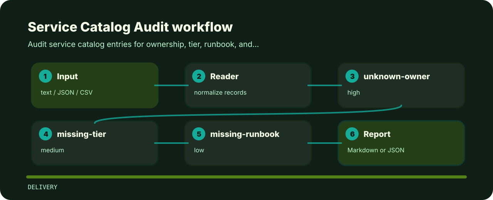

# Service Catalog Audit

| Detail | Value |
| --- | --- |
| Area | delivery |
| Entry | `service-catalog-audit` |
| Input | plain text |
| Output | terminal findings, optional JSON |

## Decision points

- `unknown-owner` - service owner is missing (high); Assign an accountable owning team..
- `missing-tier` - service tier is missing (medium); Declare criticality tier for operations..
- `missing-runbook` - service runbook is missing (low); Attach a runbook for incident response..


## Review path



## Local check

```bash
git clone https://github.com/mertefekurt/service-catalog-audit.git
cd service-catalog-audit
python -m pip install -e ".[dev]"
service-catalog-audit examples/sample.txt
```
